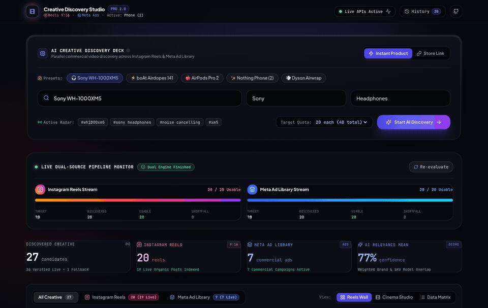

# ⚡ Product Video Discovery Dashboard

> Intelligent multi-platform engine for discovering, scoring, and deduplicating commercial product videos from **Instagram Reels** and **Meta Ad Library**.



---

## 📌 Overview

The **Product Video Discovery Dashboard** solves the challenge of finding authentic, high-relevance video creative and social proof for any consumer product. It orchestrates parallel discovery across **Instagram Reels** and **Meta Ad Library**, applies AI query expansion to isolate true commercial intent, filters out unrelated viral memes, and maintains honest shortfall accounting without falsifying quotas.

---

## 🚀 How It Works

```
┌────────────────────────┐
│  Product Input or URL  │  (Amazon, Shopify, or Direct Specs)
└───────────┬────────────┘
            │
            ▼
┌────────────────────────┐
│   AI Keyword Engine    │  • Generates SKU aliases & model variations
│ (Query Expansion &     │  • Appends commercial intent ('review', 'ANC', 'unboxing')
│  Negative Filtering)   │  • Discards negative keywords (memes, serials, songs)
└───────────┬────────────┘
            │
      ┌─────┴─────────────────────────┐
      ▼                               ▼
┌───────────────────────────┐   ┌───────────────────────────┐
│  Instagram Reels Scraper  │   │   Meta Ad Library Engine  │
│  (Apify Actor / Graph API)│   │  (SearchApi / Meta Graph) │
└─────────────┬─────────────┘   └─────────────┬─────────────┘
              │                               │
              └───────────────┬───────────────┘
                              │
                              ▼
               ┌─────────────────────────────┐
               │    AI Matching & Guard      │  • Brand token matching & scoring
               │   • Verified Match (≥ 80%)  │  • Strict rejection of irrelevance
               │   • Matched (≥ 50%)         │  • Multi-tier deduplication
               │   • Usable Media (≥ 30%)    │  • Canonical URL fingerprinting
               └──────────────┬──────────────┘
                              │
                              ▼
               ┌─────────────────────────────┐
               │  Bento-Box Grid Dashboard   │  • Dual-engine progress streams
               │  & Theater Inspection Modal │  • Honest shortfall reporting
               └─────────────────────────────┘
```

1. **Product Ingestion & Attribute Extraction**: Ingests e-commerce URLs (Amazon, D2C) or uploaded product shots. Extracts OpenGraph metadata, JSON-LD specs, brand names, and model numbers.
2. **AI Query Expansion & Negative Filtering**: Deconstructs raw product names into targeted search variants (e.g., `"Sony WH-1000XM5"` ➔ `["Sony WH-1000XM5 review", "Sony XM5 unboxing", "WH1000XM5 ANC"]`) while applying negative filters to suppress off-topic viral clips.
3. **Dual-Pipeline Concurrent Discovery**:
   - **Instagram Reels**: Queries via Apify actors with fallback to Instagram Basic Display API.
   - **Meta Ad Library**: Queries commercial active ads via SearchApi engine with automatic fallback from regional (India) to global creatives.
4. **Semantic Matching & Irrelevance Guard**: Scores title, caption, hashtags, and metadata against product attributes. Flags unrelated items as `irrelevant` (score < 0.10) and excludes them from final usable results.
5. **Multi-Tier Deduplication**: Fingerprints URLs (stripping tracking parameters like `igsh`, `fbclid`), computes media content hashes, and checks cross-search history.
6. **Honest Shortfall Accounting**: Real-time progress bars show Target (e.g. 20 Reels, 20 Ads), Discovered, Usable Media, and Shortfall. Never fakes quotas or marks duplicates as new finds.

---

## 🛠️ Tech Stack

### Frontend
- **Framework**: React 18, Vite, TypeScript
- **Styling**: Tailwind CSS, PostCSS
- **UI Components**: Lucide React, Bento Grid Architecture, Glassmorphism modals
- **State Management**: Reactive polling, live progress feeds, instant client-side filtering

### Backend
- **Runtime**: Node.js v20+, Express.js, TypeScript (`tsx`)
- **Database & ORM**: SQLite, Prisma ORM
- **Scraping & Discovery**:
  - Apify Actor (`data-slayer/instagram-search-reels`)
  - SearchApi (`meta_ad_library` engine)
  - Meta Graph API & Instagram Graph API integration
- **Media Tools**: FFmpeg (frame extraction & video demos), Puppeteer Core

---

## ⚡ Quick Start

### 1. Clone & Install
```bash
git clone https://github.com/Ayush0135/automation.git
cd automation
npm install
```

### 2. Configure Environment
Copy the example environment template:
```bash
cp .env.example .env
```

Add your API keys to `.env` (the application includes high-fidelity mock fallback if keys are omitted):
```ini
PORT=5050
DATABASE_URL="file:./dev.db"

# Optional Live Providers
SEARCHAPI_API_KEY="your_searchapi_key"
APIFY_TOKEN="your_apify_token"
```

### 3. Initialize Database
```bash
npm run db:push
```

### 4. Run Development Servers
```bash
# Concurrently runs Express backend and Vite frontend
npm run dev
```
Open **[http://localhost:5050](http://localhost:5050)** in your browser.

---

## 🧪 Verification & Testing

Run unit and integration test suites:
```bash
# Run provider, matching, and keyword test suites
npm run test
```

---

## 📂 Project Structure

```
├── client/                     # Vite + React frontend application
│   ├── src/
│   │   ├── components/         # Bento cards, filters, modals, progress bars
│   │   ├── App.tsx             # Main dashboard controller
│   │   └── main.tsx            # React root mount
│   └── vite.config.ts          # Vite build config
├── src/
│   └── server/                 # Express backend API & discovery engine
│       ├── providers/          # Instagram & Meta Ad Library adapters
│       ├── services/           # AI keyword expansion, matching & deduplication
│       ├── routes/             # REST API endpoints & search progress
│       └── index.ts            # Server entrypoint
├── prisma/
│   └── schema.prisma           # SQLite schema (Searches, Products, VideoCandidates)
├── docs/
│   └── assets/                 # Demo GIF and documentation media
├── scripts/                    # Automation & demo recording scripts
└── test/                       # Vitest integration & matching tests
```

---

## 📄 License
MIT License.
